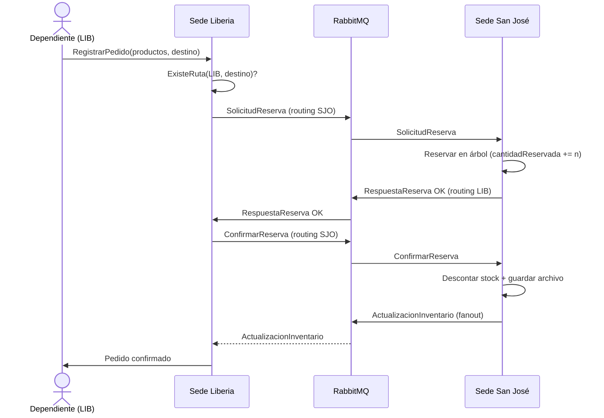

# ConviTEC – Diseño de pedidos, reservas y comunicación entre sedes (RabbitMQ)

Responsable: Persona 3 (pedidos, reservas y mensajería).

## 1. Qué se necesita

| Elemento | Detalle |
|---|---|
| Broker | RabbitMQ en **una** de las computadoras (Docker: `docker run -d --name rabbit -p 5672:5672 -p 15672:15672 rabbitmq:4-management`). |
| Usuario | Crear un usuario propio (p. ej. `convitec`). El usuario `guest` **solo funciona desde localhost**, así que no sirve para la otra computadora. |
| Red | Abrir el puerto 5672 en el firewall de la máquina del broker. 15672 es la consola web (útil en la defensa para mostrar colas y mensajes). |
| Paquete .NET | `RabbitMQ.Client` (v7, API async) en `Backend.csproj`. |
| Configuración por sede | En `appsettings.json` / variables de entorno: `Sede:Codigo` (LIB, ALA, SJO, LIM), `RabbitMQ:Host`, `Usuario`, `Clave`. Las 4 sedes son el **mismo ejecutable** arrancado con distinta configuración y puerto HTTP. |

## 2. Topología de mensajería

```
                     ┌──────────────────────────────┐
 Sede X publica ───► │ exchange "convitec.sedes"     │ (direct, routing key = código sede)
                     └──────┬──────┬──────┬──────┬──┘
                            ▼      ▼      ▼      ▼
                       sede.LIB sede.ALA sede.SJO sede.LIM   (una cola durable por sede)

                     ┌──────────────────────────────┐
 Sede X publica ───► │ exchange "convitec.inventario"│ (fanout)
                     └──────┬──────┬──────┬──────┬──┘
                            ▼      ▼      ▼      ▼
                   sync.LIB sync.ALA sync.SJO sync.LIM      (cola de sincronización por sede)
```

* **`convitec.sedes` (direct)**: mensajes punto a punto. Solicitudes de reserva, confirmaciones,
  liberaciones y sus respuestas. Cada respuesta lleva el `CorrelationId` de la solicitud.
* **`convitec.inventario` (fanout)**: difusión. Cada vez que una sede cambia su stock publica
  `ActualizacionInventario`; todas actualizan su **copia del inventario global**.
* Colas **durables** + mensajes **persistentes** + **ack manual** (solo se hace `ack` después de
  procesar y guardar en archivo). Si una sede está caída, sus mensajes esperan en la cola.

## 3. Mensajes

| Mensaje | Canal | Quién lo envía → a quién | Efecto |
|---|---|---|---|
| `SolicitudReserva` | sedes | sede del pedido → sede proveedora | Pide apartar N unidades de un producto. |
| `RespuestaReserva` | sedes | proveedora → sede del pedido | Aceptada (con `IdReserva`) o rechazada (motivo). |
| `ConfirmarReserva` | sedes | sede del pedido → proveedora | La reserva se convierte en descuento real del stock. |
| `LiberarReserva` | sedes | sede del pedido → proveedora | Se cancela la reserva y vuelven las unidades. |
| `ActualizacionInventario` | inventario | cualquier sede → todas | "Producto P en sede S ahora tiene Q disponibles". |
| `SolicitudSnapshot` / `SnapshotInventario` | sedes / inventario | sede que arranca → todas | Al iniciar, pide el inventario completo de las demás. |

Todos heredan de `Mensaje` (Id, Tipo, SedeOrigen, SedeDestino, CorrelationId, Fecha) y se
serializan a JSON. El campo `Tipo` permite al despachador saber a qué manejador enviarlo.

## 4. Flujo de un pedido (patrón "reservar → confirmar / liberar")

1. El dependiente crea el pedido (productos, cantidades, destino) → estado `Registrado`.
2. **Validar ruta** con el planificador (Persona 2): `ExisteRuta(sedeLocal, destino)`.
   Si no hay ruta → `Rechazado` con explicación (caso Guanacaste). No se reserva nada.
3. **Asignar proveedores**: con la copia del inventario global se decide qué sede surte cada
   línea (primero la local, luego otras).
4. **Reservar**: local → directo en el árbol; remotas → `SolicitudReserva`. Estado `EnReserva`.
5. Esperar todas las `RespuestaReserva` (con **timeout**, p. ej. 10 s).
6. Si **todas** aceptan → `ConfirmarReserva` a cada proveedora → estas descuentan su stock y
   difunden `ActualizacionInventario` → pedido `Confirmado` → va a la cola de pendientes de entrega.
7. Si **alguna** rechaza o vence el timeout → `LiberarReserva` a las que aceptaron →
   pedido `Cancelado` con motivo.

La **sede dueña del producto es la única autoridad** sobre su stock: aunque dos sedes intenten
reservar lo mismo al mismo tiempo (porque su copia global estaba desactualizada), la dueña
procesa las solicitudes en orden y rechaza la que no alcance. Así no se vende stock inexistente.



## 5. Robustez (para la defensa)

* **Idempotencia**: cada sede guarda los `Id` de mensajes ya procesados; un duplicado se ignora.
* **Reservas con vencimiento**: si la sede del pedido se cae antes de confirmar/liberar, la
  proveedora libera la reserva sola al vencer (`FechaExpiracion`).
* **Persistencia**: pedidos, reservas activas e inventario se guardan en archivos locales; al
  reiniciar se reconstruyen las estructuras y se pide un snapshot del inventario global.
* **Errores de conexión**: reconexión automática del cliente; si el broker no está, el pedido
  que necesita otras sedes se rechaza con mensaje claro (los locales pueden seguir).

## 6. Diagrama de clases

```mermaid
classDiagram
    direction TB

    %% ===== Dominio de pedidos =====
    class Pedido {
        -string id
        -DateTime fechaCreacion
        -EstadoPedido estado
        -string sedeOrigen
        -string destino
        -ListaEnlazada~LineaPedido~ lineas
        -string motivoRechazo
        +AgregarLinea(LineaPedido)
        +CalcularTotal() decimal
        +ObtenerSedesParticipantes() ListaEnlazada~string~
        +CambiarEstado(EstadoPedido)
    }
    class LineaPedido {
        -Producto producto
        -int cantidad
        -decimal precioUnitario
        -string sedeProveedora
        -string idReserva
        +Subtotal() decimal
    }
    class EstadoPedido {
        <<enumeration>>
        Registrado
        EnReserva
        Confirmado
        Entregado
        Cancelado
        Rechazado
    }
    class Reserva {
        -string id
        -string idPedido
        -string codigoProducto
        -int cantidad
        -string sedeSolicitante
        -DateTime fechaExpiracion
        -EstadoReserva estado
        +EstaVencida() bool
    }
    class EstadoReserva {
        <<enumeration>>
        Activa
        Confirmada
        Liberada
        Vencida
    }

    Pedido "1" *-- "1..*" LineaPedido
    Pedido --> EstadoPedido
    Reserva --> EstadoReserva
    LineaPedido --> Producto

    %% ===== Servicios (lógica de negocio) =====
    class ServicioPedidos {
        -IPlanificadorRutas planificador
        -CoordinadorReservas coordinador
        -IRepositorioPedidos repositorio
        +RegistrarPedido(Pedido) Task~ResultadoPedido~
        +ObtenerHistorial() ListaEnlazada~Pedido~
        +ObtenerPendientes() Cola~Pedido~
        -AsignarProveedores(Pedido)
    }
    class CoordinadorReservas {
        -IBrokerMensajeria broker
        -GestorReservasLocales gestorLocal
        -ListaEnlazada~SolicitudEnCurso~ enCurso
        -int timeoutSegundos
        +ReservarPedido(Pedido) bool
        +ConfirmarPedido(Pedido)
        +LiberarPedido(Pedido)
        +RecibirRespuesta(RespuestaReserva)
    }
    class SolicitudEnCurso {
        -string correlationId
        -int respuestasEsperadas
        -ListaEnlazada~RespuestaReserva~ respuestas
        -TaskCompletionSource~bool~ completado
        +RegistrarRespuesta(RespuestaReserva)
        +EstaCompleta() bool
    }
    class GestorReservasLocales {
        -IInventarioLocal inventario
        -ListaEnlazada~Reserva~ reservasActivas
        -object candado
        +Reservar(SolicitudReserva) RespuestaReserva
        +Confirmar(string idReserva)
        +Liberar(string idReserva)
        +LiberarVencidas()
    }
    class ServicioSincronizacion {
        -IBrokerMensajeria broker
        -InventarioGlobal inventarioGlobal
        +PublicarCambio(string codigoProducto, int disponible)
        +AplicarActualizacion(ActualizacionInventario)
        +SolicitarSnapshot()
        +ResponderSnapshot(SolicitudSnapshot)
    }
    class InventarioGlobal {
        -ListaEnlazada~ExistenciaRemota~ existencias
        +Actualizar(sede, codigo, cantidad)
        +SedesConDisponibilidad(codigo, cantidad) ListaEnlazada~string~
        +ConsultarCatalogo() ListaEnlazada~ExistenciaRemota~
    }
    class ExistenciaRemota {
        -string codigoSede
        -string codigoProducto
        -int disponible
        -DateTime ultimaActualizacion
    }

    class ResultadoPedido {
        -bool aceptado
        -string idPedido
        -string mensaje
        +Aceptado(string idPedido, string mensaje)$ ResultadoPedido
        +Rechazado(string idPedido, string mensaje)$ ResultadoPedido
        +GetAceptado() bool
        +GetIdPedido() string
        +GetMensaje() string
    }

    ServicioPedidos ..> ResultadoPedido : crea
    ServicioPedidos --> CoordinadorReservas
    ServicioPedidos --> IPlanificadorRutas
    ServicioPedidos --> IRepositorioPedidos
    ServicioPedidos ..> InventarioGlobal : consulta disponibilidad
    CoordinadorReservas --> GestorReservasLocales : reservas locales
    CoordinadorReservas --> IBrokerMensajeria
    CoordinadorReservas "1" *-- "*" SolicitudEnCurso
    GestorReservasLocales "1" o-- "*" Reserva
    GestorReservasLocales --> IInventarioLocal
    GestorReservasLocales ..> ServicioSincronizacion : notifica cambios
    ServicioSincronizacion --> InventarioGlobal
    ServicioSincronizacion --> IBrokerMensajeria
    InventarioGlobal "1" *-- "*" ExistenciaRemota

    %% ===== Mensajería =====
    class IBrokerMensajeria {
        <<interface>>
        +Publicar(Mensaje, string sedeDestino)
        +Difundir(Mensaje)
        +Suscribir(Action~Mensaje~ manejador)
    }
    class RabbitMqBroker {
        -IConnection conexion
        -IChannel canal
        -ConfiguracionSede config
        +Conectar()
        +Publicar(Mensaje, string sedeDestino)
        +Difundir(Mensaje)
        +Suscribir(Action~Mensaje~ manejador)
        -Serializar(Mensaje) byte[]
        -Deserializar(byte[]) Mensaje
    }
    class ConfiguracionSede {
        +string CodigoSede
        +string HostRabbit
        +int PuertoRabbit
        +string Usuario
        +string Clave
    }
    class DespachadorMensajes {
        <<BackgroundService>>
        -IBrokerMensajeria broker
        -RegistroMensajesProcesados procesados
        +ExecuteAsync()
        -Despachar(Mensaje)
    }
    class RegistroMensajesProcesados {
        +YaProcesado(string id) bool
        +Marcar(string id)
    }

    IBrokerMensajeria <|.. RabbitMqBroker
    RabbitMqBroker --> ConfiguracionSede
    DespachadorMensajes --> IBrokerMensajeria
    DespachadorMensajes --> RegistroMensajesProcesados
    DespachadorMensajes ..> GestorReservasLocales : SolicitudReserva / Confirmar / Liberar
    DespachadorMensajes ..> CoordinadorReservas : RespuestaReserva
    DespachadorMensajes ..> ServicioSincronizacion : Actualizacion / Snapshot

    class Mensaje {
        <<abstract>>
        +string Id
        +string Tipo
        +string SedeOrigen
        +string SedeDestino
        +string CorrelationId
        +DateTime Fecha
    }
    class SolicitudReserva {
        +string IdPedido
        +string CodigoProducto
        +int Cantidad
    }
    class RespuestaReserva {
        +bool Aceptada
        +string IdReserva
        +string Motivo
    }
    class ConfirmarReserva {
        +string IdReserva
    }
    class LiberarReserva {
        +string IdReserva
    }
    class ActualizacionInventario {
        +string CodigoProducto
        +int Disponible
    }
    class SolicitudSnapshot
    class SnapshotInventario {
        +ExistenciaRemota[] Existencias
    }
    Mensaje <|-- SolicitudReserva
    Mensaje <|-- RespuestaReserva
    Mensaje <|-- ConfirmarReserva
    Mensaje <|-- LiberarReserva
    Mensaje <|-- ActualizacionInventario
    Mensaje <|-- SolicitudSnapshot
    Mensaje <|-- SnapshotInventario

    %% ===== Contratos con otras áreas =====
    class IInventarioLocal {
        <<interface>>
        Persona 1
        +Buscar(string codigo) InventarioItem
        +Reservar(string codigo, int cantidad)
        +LiberarReserva(string codigo, int cantidad)
        +ConfirmarDescuento(string codigo, int cantidad)
        +Disponible(string codigo) int
    }
    class IPlanificadorRutas {
        <<interface>>
        Persona 2
        +ExisteRuta(string origen, string destino) bool
    }
    class IRepositorioPedidos {
        <<interface>>
        Persistencia
        +Guardar(Pedido)
        +CargarTodos() ListaEnlazada~Pedido~
        +GuardarReservas(ListaEnlazada~Reserva~)
    }
    class Producto {
        Persona 1 (existente)
    }
    class InventarioItem {
        Persona 1 (existente)
        -int cantidadReservada  «nuevo»
        +Disponible() int «nuevo»
    }
    IInventarioLocal ..> InventarioItem
    InventarioItem --> Producto
```

> Las colecciones (`ListaEnlazada<T>`, `Cola<T>`) son estructuras propias del grupo, ya que el
> enunciado prohíbe `List<T>`, `Dictionary`, etc.



## 7. Coordinación con el resto del grupo

* **Persona 1 (inventario)**: `InventarioItem` necesita un campo `cantidadReservada` y
  `Disponible() = cantidad - cantidadReservada`, más los métodos `Reservar / LiberarReserva /
  ConfirmarDescuento`. Acordar la interfaz `IInventarioLocal` sobre el árbol Splay.
* **Persona 2 (grafo)**: solo se necesita `ExisteRuta(origen, destino)`. Ojo: el grafo actual usa
  `List<>` y `HashSet<>`, que el enunciado no permite, y debe ser matriz de adyacencia.
* **Persona 4 (web)**: endpoints REST `POST /api/pedidos`, `GET /api/pedidos`,
  `GET /api/pedidos/pendientes`, `GET /api/inventario/global`.

## 8. Orden de implementación sugerido

1. Paquete `RabbitMQ.Client`, `ConfiguracionSede`, `RabbitMqBroker` + prueba de "ping" entre dos sedes.
2. Clases `Mensaje` y derivadas + serialización JSON + `DespachadorMensajes`.
3. `ServicioSincronizacion` + `InventarioGlobal` (lo más visible en la demo).
4. `Reserva`, `GestorReservasLocales` (lado proveedor).
5. `Pedido`, `CoordinadorReservas`, `ServicioPedidos` (lado solicitante, con timeout y cancelación).
6. Persistencia de pedidos/reservas, idempotencia, vencimiento de reservas.
7. Pruebas: reserva exitosa, stock insuficiente, ruta inexistente (Guanacaste), sede caída (timeout).
